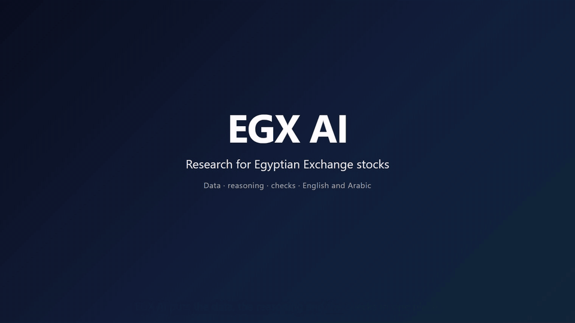

# EGX AI: research tool for Egyptian Exchange stocks

A single-user research tool for Egyptian Exchange (EGX) companies: market data, financial
statements, metrics, Shariah screening, valuation, technical signals, theses, alerts and an AI
assistant that only explains figures the app has computed.

[](docs/media/egx-ai-demo.mp4)

*Click the preview for the full demo video (MP4, about 2 minutes, English and Arabic).*

> EGX AI is a research aid, not investment advice. It never places trades, and its stances and
> fair values are model outputs under stated assumptions.

## What it does

| Area | What you get |
|---|---|
| Market data | The EGX company list and daily prices (Yahoo Finance), the EGX30 index stored daily, and a sync job you can run from the app |
| Company hub | One page per company with tabs for price and signals, financials, valuation, score, Shariah, thesis, peers, disclosures and data quality |
| Price chart | Candles with overlays, and chart patterns shown with their measured history |
| Fundamentals | Financial statements from filings (XBRL, HTML or PDF, each value traced to its page) with human approval, plus provisional imports from saved vendor files that filings always outrank |
| Metrics and valuation | Deterministic ratios, growth and margins, fair value models and an investment score, each with a methodology version |
| Shariah | Our own screen next to official EGX33 membership, never merged |
| Signals | A cross-sectional ranking and a rule-based stance (leans buy / neutral / leans reduce) with a liquidity gate |
| Monitoring | Alert rules, thesis invalidation proposals for human review, and an events ledger |
| Data quality | Coverage scores plus cross-checks: filing backing, agreement with a second source, accounting identities, price sanity and freshness |
| AI assistant | Chat about a company or the market with the model of your choice (Claude, GPT or Gemini through LiteLLM). It calls read-only tools, every figure in its answer is checked against those tools' data, it can search recent news when the model supports it (news in words only), and it labels general answers |
| Languages | English and Arabic, with a right-to-left layout and dark mode |

## Rules the code follows

The full list is in [AGENTS.md](AGENTS.md). The main ones:

- Financial formulas are deterministic code with a methodology version; an LLM never computes a figure.
- No fabricated data: missing inputs are `INSUFFICIENT_DATA`, never zero.
- Every financial number has a source, and nothing uses data published after the date it describes.
- Vendor data stays offline and is never republished; the UI never shows a vendor figure.
- No trade execution and no personal investment advice.

## Tech stack

- **Backend:** Python 3.12+, FastAPI, SQLAlchemy 2 (async), Alembic, PostgreSQL 16 with pgvector
- **Frontend:** React 19, TypeScript, Vite, TanStack Query, Tailwind with shadcn/ui, lightweight-charts
- **AI:** LiteLLM gateway (Anthropic, OpenAI, Gemini), server-sent events for streaming
- **Tooling:** pytest, ruff, mypy (strict), vitest, ESLint, Docker Compose, GitHub Actions

## Quick start

Prerequisites: Docker, Python 3.12+, Node.js 22+.

### 1. Configure

```bash
cp .env.example .env
```

Set `API_TOKEN` in `.env` to a random string of 32 or more characters. Every API route except
health requires it; the Vite dev proxy adds it server-side, so it never reaches the browser.
To save AI provider keys from the app, also set `AI_SECRETS_KEY` (the command to generate one is
in `.env.example`).

### 2. Database

```bash
docker compose up -d postgres
```

### 3. Backend

```bash
cd backend
python -m venv .venv
.venv/Scripts/python -m pip install -e ".[dev]"     # macOS/Linux: .venv/bin/python
.venv/Scripts/python -m alembic upgrade head
.venv/Scripts/python -m app.ingestion.sync          # EGX company list, prices and EGX30
.venv/Scripts/python -m app.screening.egx33         # official EGX33 Shariah membership
.venv/Scripts/python -m uvicorn app.main:app --reload --port 8000
```

### 4. Frontend

```bash
cd frontend
npm install
npm run dev
```

Open http://localhost:5173. The API runs on http://localhost:8000; its `/docs` page needs
`API_DOCS_ENABLED=true`.

### 5. AI assistant (optional)

Open **Admin → AI settings**, add a key for Anthropic, OpenAI or Gemini and pick a default
model. The monthly spending cap and free-tier providers are set on the same page.

## Development

```bash
# backend/
.venv/Scripts/python -m pytest            # uses a separate <db>_test database, never the dev one
.venv/Scripts/python -m ruff check .
.venv/Scripts/python -m mypy app

# frontend/
npm test                                  # vitest
npm run lint
npm run build                             # type check and production build
```

A change is only green with zero errors and zero warnings across all of these. CI runs the
same checks on every push and pull request.

Useful data commands (from `backend/`):

```bash
.venv/Scripts/python -m app.ingestion.sync --tickers COMI,SWDY   # refresh some tickers
.venv/Scripts/python -m app.dataquality.real_data                # companies with real fundamentals
.venv/Scripts/python -m app.signals.sanity                       # stance distribution check
.venv/Scripts/python -m app.db.purge --status                    # inspect the dev database
```

To re-record the demo video, run the app (with an AI key saved), then in a separate virtual
environment `pip install -r scripts/demo/requirements.txt`, `python -m playwright install
chromium`, `python scripts/demo/record.py`, and
`python scripts/demo/post.py <path to ffmpeg> scripts/demo/out` (the `imageio-ffmpeg` package
provides one). Copy the MP4 and GIF from `scripts/demo/out/` to `docs/media/`. The tour avoids
screens that show statement amounts, which come from vendor files.

## Project layout

```
backend/app/
  api/            thin routers, one per domain, under /api/<domain>
  <domain>/       service.py for I/O; pure modules for the maths (valuation/, signals/,
                  metrics/, performance/, dataquality/, screening/, technical/, ...)
  ai/             assistant: gateway, tools, orchestrator, number check, prompts
  ingestion/      market data and disclosure pipelines
  statements/     filing extraction, label ontology, approval, vendor import
  models/ repositories/ schemas/   ORM tables, data access, API schemas
backend/alembic/  numbered migrations
frontend/src/
  pages/ components/   screens and shared UI
  api/client.ts        every server call, as TanStack Query hooks
  i18n/                English and Arabic copy
docs/             architecture notes and phase specs
.workflow/        decisions, API contracts and the team workflow
```

[CLAUDE.md](CLAUDE.md) explains the architecture and data flow in more depth;
[PHASES.md](PHASES.md) tracks the roadmap.

## License

Private — Personal use only.
